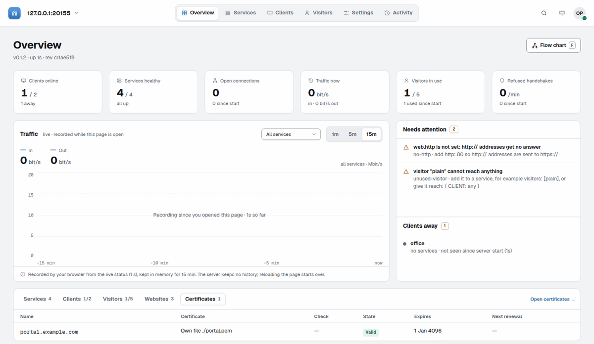
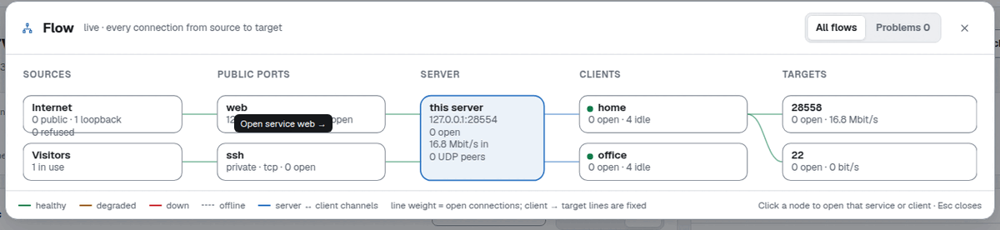
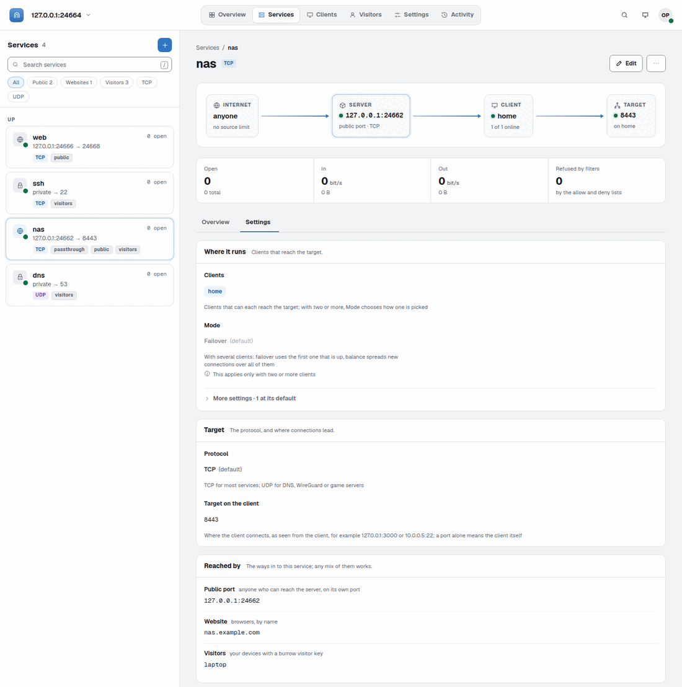
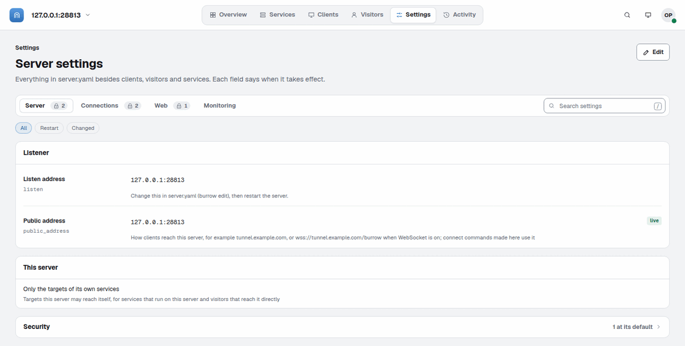
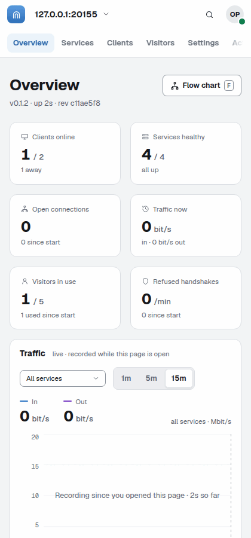
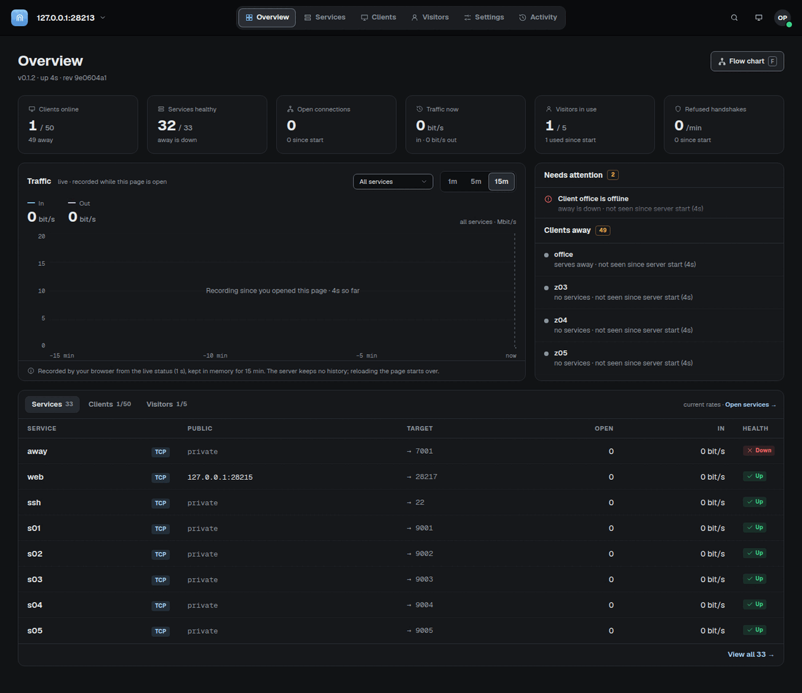

<p align="center">
  
</p>

<h1 align="center">burrow</h1>

<p align="center">
  <a href="https://github.com/CharlesNg35/burrow/actions/workflows/ci.yml"></a>
  <a href="https://github.com/CharlesNg35/burrow/releases/latest"></a>
  <a href="LICENSE"></a>
  
  <a href="docs/service.md#docker"></a>
</p>

burrow makes an app on a machine at home or in an office reachable from the internet, without opening any port on that network. A small public server receives the visitors, and a burrow client next to your app carries each connection through an encrypted tunnel. It is a reverse tunnel, like rathole or frp, with a reverse proxy for websites and a web admin built in.

```
user ──> server:7840 ══ encrypted tunnel ══ client (behind NAT) ──> your app on 127.0.0.1:3000
```

The client connects out to the server and keeps that connection open, so the router at home needs no change. The server's config decides what is exposed, and the client only reaches what it allows.

## Features

- **Fast:** 2.3 times rathole's speed with encryption on, and 13,500 new connections per second.
- **Light:** one file, nothing else to install, and 220 MiB of memory for 10,000 open connections, 13 times less than rathole with encryption.
- **Secure by default:** everything is encrypted, each machine has its own secret, and a client only reaches the targets you allow.
- **Changes apply on save:** edit the server's config and save. No restart, and nothing to change on the client.
- **Private services:** reach your home machines from your laptop, over TCP or UDP, without putting them on the internet.
- **Websites with automatic HTTPS:** many websites on one port 443, told apart by their names, with free certificates from Let's Encrypt, logins, redirects and HTTP/2.
- **Always up:** several clients per service, with failover, load balancing and health checks.
- **A clean web admin:** watch traffic and manage clients, services, visitors and settings from your browser, with a review of every change before it applies.
- **Works with AI apps:** `burrow mcp` lets Claude Code, Codex or Cursor read the server and, if you allow it, change its config through the same review.
- **Runs everywhere:** Linux, macOS, Windows, FreeBSD and Docker, as a system service, even when only HTTPS gets through to the server.

## Contents

- [Quick start](#quick-start)
- [Configuration](#configuration)
- [Services](#services)
- [Private services and visitors](#private-services-and-visitors)
- [Servers reachable only through HTTP(S)](#servers-reachable-only-through-https)
- [Websites](#websites)
- [Web admin](#web-admin)
- [Running as a service](#running-as-a-service)
- [Monitoring](#monitoring)
- [Security](#security)
- [Benchmarks](#benchmarks)
- [Development](#development)

All docs, sorted by what you want to do: [docs/README.md](docs/README.md). The words used throughout: [docs/glossary.md](docs/glossary.md).

## Quick start

You need two machines: a server with a public address, and the home machine where your app runs. At the end, a web app on port 3000 of your home machine is reachable on port 7840 of your server.

**1. Download.** [Get the latest release](https://github.com/CharlesNg35/burrow/releases/latest) for your system on both machines, and unpack it. On macOS, a browser download must be allowed once: see [docs/service.md](docs/service.md#linux-macos-and-windows-details). A Docker image is available too (see Running as a service below).

**2. On the server,** write a config and start the server:

```sh
./burrow init server   # writes server.yaml: one client named "home" and one service named "web"
./burrow server        # runs the server with ./server.yaml
```

The server now waits for clients on TCP port 7835 and will forward port 7840 to the client's port 3000. Open both ports in the server's firewall.

**3. Still on the server,** print the config for the client, with the server's public name or IP address:

```sh
./burrow client-config --server myserver.example.com -o client.yaml
```

The file looks like this. On a machine without access to the server's files, `./burrow init client` asks for the server, the name and the secret and writes a similar file, which allows `127.0.0.0/8` until you narrow it:

```yaml
# client.yaml
server: myserver.example.com:7835
name: home
secret: xPq+8DyLJNJL3x+HW8cx1Ssad1JarllpDFUdYnbV8qQ=   # the same secret as clients.home in server.yaml
allow:
  - 127.0.0.1/32:3000   # the targets this client lets the server reach
```

**4. On the home machine,** put `client.yaml` next to burrow, then start the client:

```sh
./burrow client        # runs the client with ./client.yaml
```

Now open `http://myserver.example.com:7840`: you see the app from port 3000 of your home machine.

### Next steps

- To expose more, add entries under `services` in `server.yaml` and save. The server applies the change by itself, and the client needs no change.
- To keep burrow running after a reboot, install it as a system service on each machine: `sudo ./burrow service install -c server.yaml` on the server, `sudo ./burrow service install -c client.yaml` on the client.
- `./burrow validate -c server.yaml` checks a config without starting anything.

<details>
<summary><b>All commands</b></summary>


```sh
./burrow init server|client|visitor           # write a new config (asks what it needs)
./burrow server | client | visit              # run a server, a client or a visitor (-c FILE, or the file in this folder)
./burrow validate -c server.yaml              # check a config: exit 0 valid, 1 invalid, 2 usage error
./burrow client-config office --server myserver.example.com -o office.yaml  # the config for client "office" of server.yaml
./burrow visitor-config laptop --server myserver.example.com -o laptop.yaml # the config for visitor "laptop" of server.yaml
./burrow gensecret                            # print a new random secret
./burrow edit                                 # open a config in your editor; it is checked, saved and applied
./burrow status                               # clients, services and traffic of the servers running here (-f to follow)
./burrow admin -c ops.yaml                    # the web admin, see docs/admin.md
./burrow mcp -c ops.yaml --print-config claude # let an AI app read the server over MCP, see docs/mcp.md
./burrow service install                      # run as a system service, see docs/service.md
./burrow update                               # install the latest release
./burrow schema server > server.schema.json   # JSON Schema, for completion in your editor
./burrow completions bash                     # shell completions: bash, zsh, fish, powershell, elvish
./burrow version
```

Every command has `--help`. All commands also take `--log-level`, `--log-json`, `-q` (warnings and errors only) and `--log-file FILE` (rotated at 10 MB, 5 old files kept).

</details>

## Configuration

Each machine has one config file for its role: `server.yaml` on the server, `client.yaml` on each client, and `visitor.yaml` on each of your own machines that uses private services. You mostly write `server.yaml`; burrow prints the other two for you. YAML or JSON both work, and `${VAR}` takes a value, such as a secret, from an environment variable.

This small `server.yaml` exposes one app. Addresses have short forms, and the comments say what each one means:

```yaml
# server.yaml
listen: 7835                   # 0.0.0.0:7835: all IPv4 addresses of the server
clients:
  home:
    secret: ${HOME_SECRET}     # from ./burrow gensecret
services:
  web:
    client: home
    bind: 7840                 # 0.0.0.0:7840
    target: 3000               # 127.0.0.1:3000, on the client machine
```

Saving a config applies it, on the server, the client and the visitor. `./burrow validate` shows every mistake with its line and a fix, before anything runs.

**Read more:** [docs/configuration.md](docs/configuration.md), with every key of the three files.

## Services

A service is one thing you expose: a port on the server that leads to a target the client reaches. `target` is always seen from the client, so `127.0.0.1` there is the client machine itself.

These four services show the usual kinds, one per line:

```yaml
# server.yaml, under services:
web:   { client: home, bind: 7840, target: 3000 }                        # an app on the client machine
nas:   { client: home, bind: 8080, target: 192.168.1.20:80 }             # another machine on the client's network
dns:   { client: home, protocol: udp, bind: 5353, target: 192.168.1.1:53 }  # UDP
games: { client: home, bind: 30000-30010, target: 30000-30010 }          # a port range
```

The client must allow each target in its `allow` list; `burrow client-config` writes that list for you.

Services can also limit who may connect, pass the user's real address to your app, use several clients with failover or load balancing, cap their speed, reach Unix sockets, or run on the server itself with no client.

**Read more:** [docs/services.md](docs/services.md)

## Private services and visitors

Some things should never be on the internet, like a database or SSH. A service without `bind` opens no port on the server. Only the **visitors** it lists can reach it: your own machines, each with its own name and secret, which open the service on a local port.

Here the database on the home machine is private, and only the laptop may use it:

```yaml
# server.yaml
visitors:
  laptop:
    secret: ${LAPTOP_SECRET}
services:
  db:
    client: home
    target: 5432          # no bind: private
    visitors: [laptop]
```

```
your laptop: 127.0.0.1:5432 ══ server ══ client (behind NAT) ──> 127.0.0.1:5432
```

Make the laptop's config on the server, or on the laptop itself with only the server's address, the visitor's name and its secret, then start the visitor:

```sh
./burrow visitor-config laptop --server myserver.example.com -o visitor.yaml   # on the server
./burrow init visitor                                                          # or on the laptop: asks the server what laptop may use
./burrow visit                                                                 # on the laptop: 127.0.0.1:5432 now leads to db
```

The visitor's config lists its forwards, each a local port that leads to a service:

```yaml
# visitor.yaml
server: myserver.example.com
name: laptop
secret: ${LAPTOP_SECRET}
forwards:
  db: { service: db, local: 5432 }   # a port alone means 127.0.0.1
```

`./burrow visit db --local 5433` runs one forward on another port, `./burrow init visitor --update` refreshes the forwards after the server changed, and `sudo ./burrow service install -c visitor.yaml` keeps the visitor running.

A private UDP service works the same way: its forward has `protocol: udp`, which `init visitor` and `visitor-config` write for you.

```yaml
# visitor.yaml, under forwards:
dns: { service: dns, protocol: udp, local: 5353 }   # or: ./burrow visit --udp --service dns --local 5353
```

With `reach`, a visitor can also pick any target on a client by itself, like `ssh -L`, with no service for each one. The client's `allow` list must permit those targets too. This lets the laptop reach SSH on the client and its whole home network:

```yaml
# server.yaml
visitors:
  laptop:
    secret: ${LAPTOP_SECRET}
    reach:
      home: [127.0.0.1/32:22, 192.168.150.0/24]   # port 22 on the client itself, and its whole network
```

On the laptop, each command opens one local port:

```sh
./burrow visit --client home --target 22 --local 2222                  # --target 22 means 127.0.0.1:22 on the client; then: ssh -p 2222 localhost
./burrow visit --client home --target 192.168.150.44:22 --local 2222   # a machine on the client's network
./burrow visit --client home --target 192.168.150.3:3000 --local 3000  # a web app there; then open http://localhost:3000
./burrow visit --client home --socks 1080                              # a SOCKS5 proxy into the client's network (TCP and UDP)
curl --socks5-hostname 127.0.0.1:1080 http://nas.local:5000            # then any app can use it
```

The same forwards in `visitor.yaml`:

```yaml
# visitor.yaml
forwards:
  ssh:   { client: home, target: 22, local: 2222 }
  nas:   { client: home, target: 192.168.150.44:22, local: 2223 }
  socks: { client: home, socks: true, local: 1080 }
```

`reach: { home: any }` allows any target the client allows; `validate` reminds you to keep the client's `allow` list narrow then.

**Read more:** [docs/visitors.md](docs/visitors.md), with the server.yaml and visitor.yaml for each of these.

## Servers reachable only through HTTP(S)

Some servers can only be reached on the usual web ports: they sit behind nginx, Caddy, Cloudflare or a Kubernetes ingress, or a firewall lets only HTTPS through. Clients can then connect over WebSocket, which passes through web servers and proxies, and burrow's own encryption still protects the data. Turn it on in the server's config, and give the client the URL:

```yaml
# server.yaml
websocket:
  listen: 127.0.0.1:7836   # point your web server at this
  path: /burrow
```

```yaml
# client.yaml
server: wss://tunnel.example.com/burrow
```

**Read more:** [docs/websocket.md](docs/websocket.md), with ready configs for nginx, Caddy, Cloudflare, Cloudflare Tunnel and Kubernetes, and for burrow serving `wss://` itself.

## Websites

burrow can serve your apps as websites: a browser opens `https://blog.example.com`, and burrow sends the request through the tunnel to the app at home. Many websites share one HTTPS port on the server, usually 443, told apart by their names. burrow does the HTTPS itself, with free certificates from Let's Encrypt that it gets and renews by itself, or with your own files; or it passes the encrypted connection to an app that does its own HTTPS.

This config serves a website with automatic HTTPS:

```yaml
# server.yaml
web:
  https: 443 # IPv4 and IPv6
  http: 80   # sends http:// visitors to https://
  letsencrypt:
    email: ops@example.com # writing this accepts Let's Encrypt's terms
services:
  blog:
    client: home
    target: 8080
    web: blog.example.com
```

Point `blog.example.com` at the server in your DNS, open ports 443 and 80, and the site is up once its certificate arrives. Logins, paths, redirects, HTTP/2 and gRPC are a few lines more.

A device that already does HTTPS, like a NAS, keeps its own certificate with `tls: passthrough`, and burrow only reads the name:

```yaml
# server.yaml
web:
  https: 443 # IPv4 and IPv6
services:
  nas:
    client: home
    target: 192.168.1.20:443
    web: { hosts: [nas.example.com], tls: passthrough }
```

`burrow validate` lists each name, where it leads and where its certificate comes from. The tunnel can share the port too, on a name of its own, so clients connect to `wss://tunnel.example.com/burrow` on 443.

**Read more:** [docs/web.md](docs/web.md), and [ready configs for common apps](docs/web/recipes.md) like Home Assistant, Nextcloud and Grafana.

## Web admin

`burrow admin` opens a clean web admin on your own machine. Watch live traffic, clients, services, visitors, websites and certificates, and add or change them in forms that explain every field. Each change shows a review with the diff and what it affects before it is applied, earlier versions can be reverted, and the server refuses a change that would lock you out.

It connects to the server as a visitor with admin access, so the server opens no new port. Give one visitor that access:

```yaml
# server.yaml
visitors:
  ops-laptop:
    secret: ${OPS_SECRET}
    admin: write # or read: look, but change nothing
```

Then print its config on the server, and open the admin with it on your machine:

```sh
./burrow visitor-config ops-laptop --server myserver.example.com -o ops-laptop.yaml   # on the server
./burrow admin -c ops-laptop.yaml                                                     # on your machine: opens the browser
```

<details>
<summary><b>Screenshots</b></summary>

The Overview: live counts, traffic, what needs attention, clients that are away, and a table of services, clients and visitors (with websites and certificates once the web proxy is on).



The flow chart: every path from the internet and the visitors, through the server and the clients, to the targets.



A service page: how connections flow, and "Reached by", the ways in to this service: a public port, a website and visitors.



Settings, in four tabs: Server, Connections, Web and Monitoring, with one search across all of them. Here the Web tab, with the web proxy's ports, Let's Encrypt and the local certificate authority.



On a phone, and in dark mode:

 

</details>

**Read more:** [docs/admin.md](docs/admin.md). For Claude Code, Codex or Cursor, `burrow mcp` gives an AI app the same admin access over MCP: [docs/mcp.md](docs/mcp.md).

## Running as a service

One command makes burrow start at boot and restart after a failure, on Linux (systemd), macOS (launchd) and Windows. It copies burrow and the config to system folders and runs it under its own account:

```sh
sudo ./burrow service install -c server.yaml   # or client.yaml, or visitor.yaml
burrow service status                          # is it running, and which files does it use
sudo burrow service logs -f                    # follow its log
sudo burrow update                             # install the latest release and restart the services
```

burrow is also available as a Docker image, `ghcr.io/charlesng35/burrow`.

**Read more:** [docs/service.md](docs/service.md), with where the files go, updating and Docker.

## Monitoring

`burrow status` shows the servers running on this machine, with their clients, services, visitors, websites, certificates and traffic. It needs no setup:

```sh
sudo burrow status       # once
sudo burrow status -f    # live, with rates, until Ctrl-C
```

Prometheus metrics are available too, off unless you turn them on, and so is the live dashboard of `burrow admin`.

**Read more:** [docs/monitoring.md](docs/monitoring.md)

## Security

All traffic between the server, clients and visitors is encrypted. Each client and visitor has its own secret, and a client only connects to the targets its own `allow` list permits. Make every secret with `./burrow gensecret`, and never use a password.

**Read more:** [docs/security.md](docs/security.md), and the wire protocol in [docs/protocol.md](docs/protocol.md).

## Benchmarks

burrow is measured against rathole, frp and chisel on one machine (i5-12600K, 10 vCPUs), everything on loopback, with `bench/run.sh`:

|                               | burrow (default)       | rathole 0.5 (noise) | frp 0.71 (default) | chisel 1.12 |
| ----------------------------- | ---------------------- | ------------------- | ------------------ | ----------- |
| throughput, 1 / 4 streams     | **12.6 / 33.4 Gbit/s** | 5.4 / 18.1          | 8.5 / 8.8          | 6.0 / 5.6   |
| new connections/s             | **13.5k**              | 5.9k                | 10.0k              | 11.8k       |
| p99 latency under load        | **549 µs**             | 769 µs              | 678 µs             | 1057 µs     |
| RSS with 10k idle connections | **220 MiB**            | 2784 MiB            | 796 MiB            | 719 MiB     |

With `cipher: aes-gcm` burrow reaches 22.3 / 49.9 Gbit/s. Over WebSocket it does 11.8 / 31.1 Gbit/s with 391 MiB for 10k idle connections (chisel, also WebSocket: 6.0 / 5.6 Gbit/s, 719 MiB). Unencrypted, burrow moves 2.1x rathole's plain TCP throughput with one stream (1.3x with four) and opens 7% fewer connections per second (14.2k vs 15.3k).

**Read more:** [docs/benchmark.md](docs/benchmark.md), with the full table, the machine and the exact commands. Reproduce with `bench/run.sh`.

## Development

burrow is written in Rust. These commands run its tests:

```sh
cargo test                                            # unit, integration, security, diagnostics, init
cargo test --release --test heavy -- --ignored --test-threads=1   # 10k connections, soak, chaos, churn and leak checks
cd fuzz && cargo +nightly fuzz run config            # cargo fuzz list shows every target
tests/e2e/proxies.sh                                  # wss:// through real nginx and Caddy containers (needs docker)
BURROW_TEST_TRANSPORT=ws cargo test --test integration   # run the integration suite over WebSocket
```

`make help` lists the common commands (GNU make on Linux and macOS; on Windows use cargo and `cargo xtask` directly).

The code rules are in [CONTRIBUTING.md](CONTRIBUTING.md). Design notes: [docs/decisions.md](docs/decisions.md) and [docs/research.md](docs/research.md). The wire protocol: [docs/protocol.md](docs/protocol.md). Working on the admin UI: [docs/admin-ui-dev.md](docs/admin-ui-dev.md).

## License

MIT
