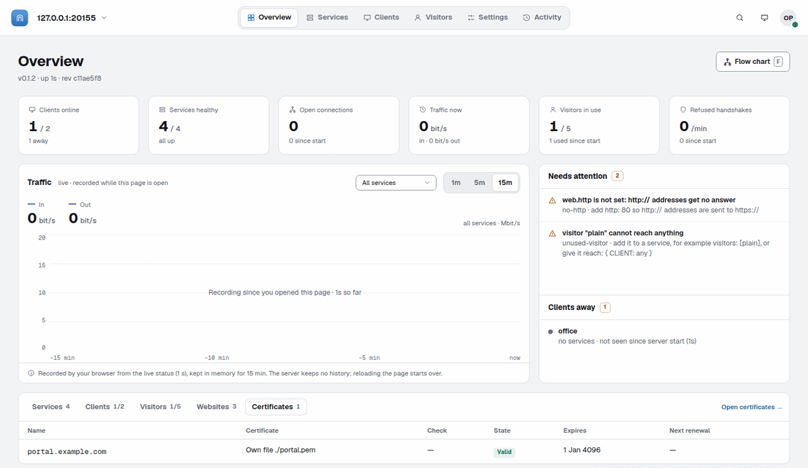

# burrow admin

`burrow admin` is a web admin for a running server, opened in the browser on your own machine.

- Watch live traffic, clients, services, visitors, websites and certificates.
- Change them in forms that explain every field, instead of editing YAML by hand.
- Every change is checked as `burrow validate` does, and shown as a diff with what it affects before it applies.
- Your file keeps its comments, and earlier versions can be reverted.

It runs on your machine with a visitor config that has admin rights, so the server opens no new port.



Back to the [README](../README.md).

- Working on the UI itself: [admin-ui-dev.md](admin-ui-dev.md).
- All server keys: [configuration.md](configuration.md).
- For AI apps, the same admin access over MCP: [mcp.md](mcp.md).

## Setup

Give one visitor admin rights in the server's config:

```yaml
# server.yaml
visitors:
  ops-laptop:
    secret: ${OPS_SECRET}
    admin: write # read | write
    admin_from: [203.0.113.0/24] # optional: admin only from these addresses
```

- `admin: read` shows everything and changes nothing; `admin: write` may also change the config.
- `admin_from` limits admin access to these source IPs or CIDRs. Without it, admin works from any address the visitor can connect from.
- Use a dedicated visitor for admin, so one leaked secret never gives both admin and services. `validate` warns when an admin visitor also reaches services or has `reach`.

Then, on the server, print the config for that visitor, and copy it to your machine:

```sh
burrow visitor-config ops-laptop --server myserver.example.com -o ops-laptop.yaml
```

`--server` is the server's public name or IP address; leave it out when server.yaml sets `public_address`. A visitor with admin access and nothing else gets a config without forwards, and `visitor-config` says to open it with `burrow admin`. It needs no `burrow visit`.

## Running it

Start it on your machine with the visitor's config. It opens the browser:

```sh
burrow admin -c ops-laptop.yaml     # opens the browser on http://127.0.0.1:7839
burrow admin --no-open --print-url  # ./visitor.yaml, or the one installed visitor service
```

- The browser opens a private launch file that forwards to the UI with its token. It is written to a folder only you can use (`$XDG_RUNTIME_DIR/burrow`, else `burrow-<uid>` in the temp folder; `%TEMP%\burrow` on Windows), and it is deleted when `burrow admin` stops.
- Without `-c`, it uses `./visitor.yaml`, or else the installed visitor service; `--service NAME` picks one of several.
- `--no-open` does not open the browser, and `--print-url` prints the link with its token. `--url-file FILE` writes the link to a file only you can read. If the link file or the launch file cannot be written, `burrow admin` says why and exits at once.
- The UI listens on 127.0.0.1:7839, or on the port of the session it reuses, so an open tab reconnects. If that port is taken, it says so and uses a free one. `--port N` uses exactly N and fails when it is taken; `--port 0` always takes a free one.
- A visitor without admin rights gets an error in the terminal and no browser opens.
- It stops after 30 minutes without a browser tab; `--idle-exit` changes that, like `90s`, `30m` or `2h`.
- Each browser tab and each `burrow mcp` holds one admin session on the server: up to 32 per visitor and 64 per server, so many tabs and AI apps can share one visitor.
- If the page says "Open the link from your terminal", it was opened without the token: use the link `burrow admin` opened or printed, or run it again with `--print-url`.
- `burrow admin --ui-info` prints the version and size of the built-in UI, and exits.

## The pages

The bar at the top has:

- Overview, Services, Clients, Visitors, Settings and Activity.
- On the left, the server's name opens a menu with its listening addresses, its config file and **About this server**.
- On the right are search, the theme, **Review** with the number of changes waiting, and your account menu.

What each page shows:

- **Overview** shows:
  - live counts: clients online, services healthy, open connections, traffic now, visitors in use, refused connections per minute;
  - a traffic chart for all services or one, over 1, 5 or 15 minutes;
  - **Needs attention**;
  - below, a table with tabs for Services, Clients and Visitors, plus Websites and Certificates when the web proxy is on.

  The traffic chart is recorded by your browser and starts over when you reload the page; the server keeps no history.
- **Needs attention** lists what to look at. Most items open the place that fixes them:
  - a service that is down, has a failing health check or cannot listen;
  - an offline client;
  - a config file with errors;
  - a setting that waits for a restart;
  - a certificate that cannot be issued or ends soon;
  - an update that failed;
  - a server older than this burrow admin.
- **Flow chart** (the button on the Overview, or the `F` key) draws every path from the internet and the visitors, through the server and the clients, to the targets. **Problems** shows only the paths with a problem. Click a service or a client to open it; `Esc` closes.
- **Services, Clients, Visitors:** a list with a search and filters on the left, and the picked item on the right. The filters:
  - Services: Public, Websites, Visitors, TCP, UDP.
  - Clients: Online, Offline.
  - Visitors: Admins, In use.

  Websites are services with a website: the Websites filter lists them, and their settings are on the service's page. A service page shows how connections flow and its health per client.
- An item's page has tabs. The ⋯ menu has Rename, Delete and Copy name.
  - A service: Overview and Settings.
  - A client: Overview (its figures, its burrow version and the services it serves), Secrets, Settings and Connect.
  - A visitor: Access (admin rights, `admin_from`, reach and limits), Secrets, Connect and Settings.
- **Secrets** lists each secret by its fingerprint, where it comes from (the config file it is in, or an environment variable) and whether the connected session uses it. **Generate a secret** or **Rotate secret** has the server make a new one; remove the old one once the client or visitor uses the new one.
- **Connect** gives the ready config for that client or visitor, as one of:
  - commands for Linux, macOS or Windows with a link to download burrow;
  - the `client.yaml` or `visitor.yaml` file;
  - the same with the secret in an environment variable.

  A client's allow list comes from the services that use it, a visitor's forwards from the private services it may use. The secret is not in it: `burrow init` asks for it. When the server's address is not known, type it, or set Public address in Settings, Server.
- **Activity** lists every version of the config by time, with what changed and who changed it. Filter by Admins or Hand edits, or search the history. A hand edit of server.yaml shows up with the next change.
- **About** shows:
  - the server's version and system, and its uptime;
  - the burrow admin version;
  - who you are signed in as and from where;
  - the config file, whether the server can write it and why not;
  - the history folder;
  - versions for support.

  **Copy diagnostics**, also in the account menu, copies these for a bug report.

Moving around:

- **Search** (the magnifier, or `/`) finds pages, services, clients and visitors by name, settings, Activity entries and actions like "New client…", "Rotate secret of home…" or "Review". Arrow keys and `Enter` pick one; `Esc` closes. On a list page, `/` goes to the list's search.
- Times read like `5m` or `2h 5m`; hover one for the exact moment.
- The theme is System, Light or Dark, from the button at the top or the account menu, and is kept in your browser.
- On a phone, a list and an item's page show one at a time, with a back arrow at the top, and the Overview's tables become cards.
- When the connection drops, a banner counts down to the next try and offers **Retry now**. Your changes not applied yet are kept.
- A **Read-only** tag at the top says why when you cannot change anything: the visitor has `admin: read`, or the server cannot write its config file, with the command that fixes it.

## Adding and changing things

- **New client** and **New visitor** (the + button on their list): type a name; the server makes the secret. Optionally set the most connections and the services it serves, or may use. **Add to changes** keeps it with your other changes; **Create and apply** applies it at once.
- After the apply, the secret is shown once, with the ready config and commands as on the Connect tab, with the secret filled in. Copy or download it then; afterwards only its fingerprint shows. For a new client the page waits until it connects, and says from where. **Done** closes it once you tick "I have saved the secret".
- **New service** (+ on Services, then Service) takes a name; set its client and target on its page next. **New website** (+, then Website) asks for the names, the client and the app's port on it, and HTTPS.
- To change an item or the settings, click **Edit**, change the fields, and click **Add to changes**, or **Discard**. Change as many items as you like; **Review** at the top counts them. Closing or reloading the tab with changes not applied asks first.
- Review shows the diff, in one column or side by side, what it affects, and every error and warning, checked by the server as `burrow validate` does. **Apply** writes it; **Discard all** drops every change.

## Installed servers

An installed server can write its config only when it has an admin visitor, or was installed with `service install --admin-writable`. Its config folder, `/etc/burrow/<name>/`, then belongs to the service's account. Otherwise the folder belongs to root, and the UI is read-only and shows the command that makes it writable. Nothing moves either way.

[service.md](service.md#changing-the-config) shows how to add admin access to a server installed without it.

The installed copy is then the config: the file you installed from was only its first version, and `service status` says so instead of suggesting a reinstall.

A reinstall, for example to change `--run-as`, still copies the source over it:

- If the installed copy differs, it is first kept as a version in its history, so you can go back to it from Activity.
- A reinstall from the source file also brings back admin access you revoked in the UI, because the source still has it; revoke it in the source too.

## Locked fields, history and revert

What the pages do, and what stays a file edit:

- A service page says how the service is reached: a public port, a website and visitors, in any mix. Turning one off keeps its values until you add the change, and Review says what goes: the port that closes, the website and its settings, or the visitors that can no longer reach it.
- Settings has six tabs:
  - **Server:** the listener, this server and security.
  - **Connections:** WebSocket, ready connections to clients, heartbeat, TCP, UDP and limits.
  - **Web:** the web proxy, Let's Encrypt, its DNS check providers, your own certificates and the local CA.
  - **Monitoring.**
  - **Files:** the config file and its [drop-in files](#drop-in-files). A server older than v0.2.4 has no Files tab.
  - **Config file.**

  The search and the All, Needs a restart and Changed filters above them look through every tab, and each tab says how many of its settings match, are changed or are locked.
- **Config file** shows the server's config as YAML, for read and write admins alike.
  - With [drop-in files](#drop-in-files) it shows the whole config the server reads: server.yaml first, then each drop-in's services, clients and visitors under a `# from server.d/<file>` line.
  - It shows the keys the files set; **Show defaults too** adds every default in effect.
  - Secrets never show: each one reads as its fingerprint, like `«secret 3f2a9c1d»`, or as the `${ENV}` name it comes from, and a password hash reads `«password hash»`. This is the same view `burrow mcp` gives with `get_config`.
  - **Copy** and **Download** take that same text; the download is named like `server.redacted.yaml`, because it is not a working config without the secrets.
  - When the running server differs from the file, a note at the top links to Needs attention. That is when the file has errors, a change waits for a restart, or something in it could not be opened.
  - **Edit** (write admins, servers from v0.2.4) opens the files as text, one tab per file: server.yaml and each drop-in. A file read-only on disk says why and stays as it is.
    - Each secret reads as a placeholder like `«secret 3f2a9c1d»`; leave it to keep the secret, or type a new value over it. A placeholder works only in the field it came from, also when you move the item to another file; anywhere else the change is refused, naming the file, line and field. `${VAR}` and `file:` references show as written.
    - Problems show as you type, the server's own a moment later. **Review changes** (or Ctrl+S) opens Review with a diff per file; the two locked settings below are refused here too.
  - Change the config also in the other tabs, on the entity pages or with `burrow edit`.
- Two settings are shown but are changed only in server.yaml on the server: a DNS provider's `command`, which runs a program on the server, and `update.remote`, which only root turns on. The server refuses changes to them. Every other setting, file paths included, is changed here.
- Moving `listen` is checked like a web port and takes effect when the server restarts. Turning off encryption of forwarded data (`insecure_plaintext`) reconnects every client. Review asks you to type the setting's name for both.
- The access log is turned on here with a file in the server's own folders: its state folder, or its log folder when it runs as a service. A file anywhere else is set in server.yaml, because a log line holds text a visitor chose, and a shell's startup file there could run it.
- Where a setting is one of several choices, like a DNS provider or a certificate's files or upload, it is one list: pick one, and only its fields show. Switching to another clears the first one's fields, after a confirm when they hold values.
- The web proxy's ports are changed in Settings, and New website turns the web proxy on when the server has none. How ports and addresses are checked:
  - Review names each port a change opens and the websites a removal stops.
  - Moving a port the tunnel shares asks you to type `websocket` and names the clients connected over WebSocket now, which are cut off.
  - A port another program holds is refused before anything is written.
  - A port below 1024 that the server may not open is a warning at the field, with what to do: install the service again, or `setcap` for a server run by hand.
  - Every check that has a hint shows it under its message, at the field and in Review.
  - An address that is not one of this server's gets a warning at the field before saving.
  - A changed service port that another program holds, TCP or UDP, is refused before saving like a web port.
  - A service that cannot listen after a change is listed in Needs attention with the reason, because a restart would fail until it can.
  - Each Settings tab shows how many problems its settings have.
  - Moving a service to a client whose allow list does not cover the target gets a warning before saving, since that client would refuse it. The allow list is the one the client sent when it connected.
  - Review's impacts describe only what your changes do to the config file; an address in the file that the server could not open is listed in Needs attention.
- An address field's first choice says what a port alone listens on for that setting, and it saves the port alone. For example:
  - "All IPv4 and IPv6 (default)" for the web ports;
  - "All IPv4 (default)" for a service's public port;
  - "This machine only (default)" for metrics.

  `0.0.0.0`, `::` (IPv4 and IPv6) and `127.0.0.1` can be picked on purpose. Picking an address before typing the port leaves the field unset, not invalid.
- WebSocket can be turned on, moved or turned off from Settings. The server first checks that a new port is free, and Review names the clients connected over WebSocket now: they are cut off and need their own config changed. A session that itself comes over WebSocket can move or turn off that listener too, after you type `websocket`; the session then ends, and you connect again at the new address.
- Before each change from burrow admin, the previous file is kept beside it in `.server.yaml.history/` (the last 20, mode 0600).
  - Activity lists the versions by the time they were applied, with who applied each one, from where and what changed, also after a server restart. A version burrow admin did not write shows as a hand edit.
  - Those facts are kept in a small `audit-….json` next to each version: one entry for every change that made it, with the change lines as Activity shows them and never a value.
  - You can go back to each after a review.
  - When that folder cannot be written, the history is kept in memory only.
- Every change goes through a review page, with what changes in server.yaml and what it affects, before it is applied, and a hand edit made meanwhile shows as a conflict instead of being overwritten.

## Certificates and Let's Encrypt

Settings, **Web** holds the certificates, each in its own card ([certificates.md](web/certificates.md)):

1. **Let's Encrypt:** turn it on and give the email. More settings holds the certificate authority (Let's Encrypt, its test servers, or another ACME server's address), a CA to trust for it, and the certificate profile. Turning it off warns at once when websites would be left without a certificate, and names them.
2. **DNS check providers** shows while Let's Encrypt is on.
   - Click **Add DNS provider**, type the domains it manages (`example.com` covers every name under it), and pick the provider: Cloudflare, RFC 2136, acme-dns, or a command of yours (set in server.yaml). Only that provider's fields show.
   - A credential, like Cloudflare's API token, is a **Variable** (`${CF_TOKEN}`, from the server's environment), a **File** (`file:/etc/burrow/cf.token`) or a **Value** typed in. It is never shown again, only that it is set.
   - "How to make one" opens the provider's setup steps.
   - **Shared wildcards** like `*.example.com` give one certificate for a whole domain; wait time and resolvers are under More settings.
3. **Your own certificates:** add the names a certificate serves, then upload its certificate and key, or pick **Files on the server** and name files another tool keeps up to date, like certbot's `/etc/letsencrypt/live/example.com/fullchain.pem`.
4. **Local certificate authority:** its fingerprint and the download of its certificate, for `tls: internal` sites.

A website picks its certificate on its page, under HTTPS:

- Automatic (Let's Encrypt or a matching entry of Your own certificates);
- the local CA;
- My own certificate (an upload);
- passthrough;
- off.

Its Let's Encrypt check (`challenge`) is under More settings. A wildcard name needs the DNS check, and Automatic uses it by itself for a name whose domain a DNS provider lists when ports 443 and 80 are not the web proxy's.

**New website** asks the same HTTPS question and tells at once when Let's Encrypt cannot check a name or the local CA cannot sign it; with My own certificate it opens the new site on its upload.

A certificate that cannot be issued, renewed or is near its end shows in Needs attention and at the site's HTTPS setting, where the item leads.

## Client versions and updates

The Overview's Clients tab has the columns Client, From, Open, Since, Version, System and Services:

- **Version** shows "0.2.3 available" when a newer release waits. On hover it says why it cannot be updated from here, for example "remote updates are off in its config".
- **System** shows the system alone, like `linux/arm64`.
- **Services** shows how many services the client serves ("2 services"), with the names on hover.

A client's page shows its burrow among its figures:

- the version;
- a short line like `linux/arm64 · started by hand`;
- the "0.2.3 available" tag;
- for a write admin when the update is possible, an **Update** button.

A running update or its result shows as the tag, with the details on hover.

How updates from here work:

- **Update all** updates the clients that can take the newer release, one at a time, and stops at the first one that fails.
- A client is never offered a release newer than the server's: it says "the server runs 0.2.2; update the server first to 0.2.3", and **Update all** skips it.
- Each update dialog links "What's new in 0.2.3" to the release's page on GitHub.
- The client downloads and checks the release itself, and goes back to its old version if the new one does not connect within a minute.
- Clients older than 0.2.2 show as "older than 0.2.2": update them by hand once.

See [updates.md](updates.md).

## Updating the server

When a newer release exists for the server, the Overview's header gets a second line: "0.2.3 available · What's new" (the release's page on GitHub, in a new tab).

When root installed the server as a service with `update.remote: true`, a write admin also gets an **Update** button there:

1. It confirms first, because the server restarts and clients, visitors and websites pause for a few seconds.
2. The line shows "updating, the server restarts…", and the tab reconnects on its own.
3. The line then shows the result, "rolled back" with the reason if the new release was not healthy within a minute.

Otherwise there is no button, and hovering "0.2.3 available" says how to update instead, for example "update it with sudo burrow update" for a server started by hand.

Settings shows `update.remote` locked: only root turns it on. See [updates.md](updates.md#update-the-server-from-burrow-admin).

## Drop-in files

When the server reads a folder of drop-in files ([configuration.md](configuration.md#drop-in-files)), the admin shows which file each service, client and visitor is in, and writes every change to that file:

- **Edit** changes an item in its own file and keeps the file's comments.
- **Add** writes a new item to `server.yaml`, or, with **Save in**, to a file of its own (`server.d/<name>.yaml`) or to another drop-in file.
- **Split into its own file** and **Merge into server.yaml** in an item's ⋯ menu move it between files. When a drop-in file is left with nothing in it, Review offers to delete it.
- **Rename** with references updates them in every file; it is refused when a reference sits in a read-only file.
- **Review** shows one diff per file ("server.yaml: no change").
- **Settings → Files** lists each file, how many items it holds and whether it is read-only; its links open the list of that file's items.
- A file that is **read-only on disk** shows a lock; its items can be looked at but not edited, renamed, moved or removed.
- A change is written to every file it touches or to none. If a file changed on disk since you opened your change, it is refused and names the file; review your change again.
- **History** keeps the whole set of files, and a revert puts back every writable file, creating or deleting drop-in files as needed.

`burrow mcp` follows the same rules, with the `place` and `drop_file` operations for moving items and deleting an empty file.

## Mixed versions

The burrow on your machine and the one on the server don't need the same version.

- A newer burrow admin works with an older server: it says the server is older in Needs attention, and leaves out what that server cannot do.
- An older burrow admin, for example v0.1.2, can open a newer server too. When the config uses settings it doesn't know, such as clients with their own target or weight, websites or named login services, its Needs attention lists them ("This burrow admin is older than the server and cannot edit some settings here: …"), and it shows them as text instead of a form. Editing stays allowed, because the server checks every change. To edit those settings in forms, update burrow on your machine.

An admin older than v0.2.4 can still change items in `server.yaml`; the server refuses its changes to items in drop-in files, with a message saying so.

## Security notes

The admin can change the server's config, so it is guarded closely:

- The UI listens on `127.0.0.1` only, and needs a random token that is never on the command line. The token is kept for up to 12 hours per visitor config, in a file only you can read, so an open tab reconnects when you run `burrow admin` again. Expired session files are deleted the next time `burrow admin` starts. For a remote machine, use `ssh -L`.
- Secrets are generated by the server and shown once; existing secrets never leave the server. A session holds up to 256 new secrets and passwords that are not applied yet, each for 30 minutes.
- Credential headers in `request_headers` and `response_headers`, like `Authorization`, `Cookie` or `X-Api-Key`, show by name only, also to read-only admins, in diffs and in the server's log ([Headers](web/headers-limits-pages.md)).
- burrow admin may write `${VAR}` and `file:` references wherever server.yaml allows them, like a DNS provider's `${CF_TOKEN}`. `burrow validate`, status, Review, the Config file tab and the Overview show a reference as written, never its value.
- Admin access is the protection. A write admin can give a visitor `admin`, raise `read` to `write`, add a secret to an admin visitor, widen its `admin_from` and rename an admin visitor, as in Portainer, Nginx Proxy Manager or Cloudflare. Keep admin secrets and `admin_from` tight.
- The server refuses two changes: removing the visitor you are signed in as, and leaving no visitor with write access.
- A change that ends your own session asks you to type your visitor's name in Review: lowering your level, removing the secret you signed in with, an `admin_from` that leaves out your address, or moving the listener you came in through. After Apply the session ends, and the page says what to do next.
- To rotate your own secret, rotate it on your visitor's Secrets tab, apply, sign in with the new secret, then remove the old one.
- On every reload, the session checks its visitor again. It ends when the right, the secret or the source address is gone, or when its level changes; the next session opens with the new level.

## Next steps

- [burrow mcp](mcp.md): the same admin access for an AI app.
- [Monitoring](monitoring.md): `burrow status` and metrics, without a browser.
- [Running as a service](service.md#changing-the-config): make an installed server writable for the admin.
